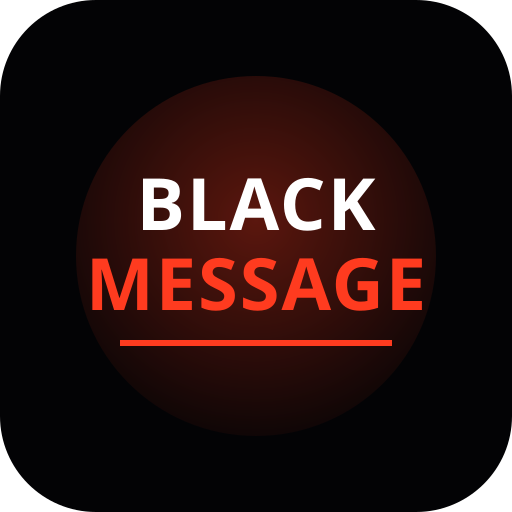

# BLACKMESSAGE

IF YOU JAST TRY IN WEB SITE GO TO THIS LINK

**BLACKMESSAGE** is a dark, fast messenger for Android and Windows. Chat, share files and keep your conversations private.

## Bio
Built by **SKIRO-7** (GitHub: [@saberssr114](https://github.com/saberssr114)). I make websites, apps and tools — BLACKMESSAGE is a messenger with a dark theme, 3D motion and a game-like feel.

## Downloads
- Android: `BlackMessage.apk`
- Windows: `BlackMessage-Setup.exe`
- Website: `BLACKMESSAGE.html`

## Logo
The app logo is `logo.svg` (512×512). Use it for app icons and the GitHub social preview.

## Publish on GitHub Pages
1. Create a new repository on GitHub.
2. Push this folder to the repository.
3. In the repository settings, enable **Pages** → Source: **GitHub Actions**.
4. The workflow in `.github/workflows/pages.yml` deploys the site automatically.

> Note: binary files are large. Consider using Git LFS for `*.apk` and `*.exe`.
